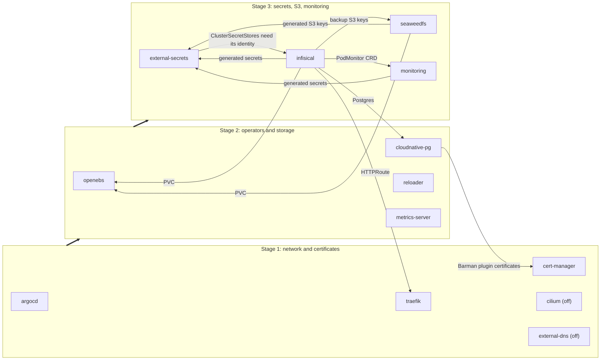

# Progressive sync

`appset.yaml` deploys the components in stages (`stage:` field of each entry).

A stage starts when every app of the previous stage is Healthy.

Components that depend on each other both ways go in the same stage: they converge on retries.

Arrow = "needs".

Change a stage: edit `stage:` in `appset.yaml`. A component without a known stage goes in the last stage.
